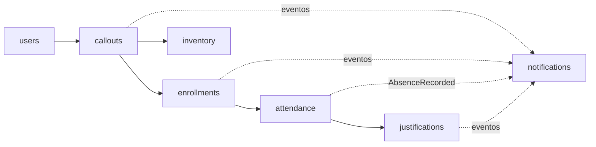

# Arquitectura

Cada módulo sigue `Controller → Application → Domain Service → Domain`; aplicación usa puertos de repositorio. No hay claves foráneas entre módulos.

| Evento | Publica | Escucha |
|---|---|---|
| CalloutPublished | callouts | notifications |
| EnrollmentConfirmed | enrollments | notifications |
| AbsenceRecorded | attendance | justifications, notifications |
| JustificationResolved | justifications | notifications |
